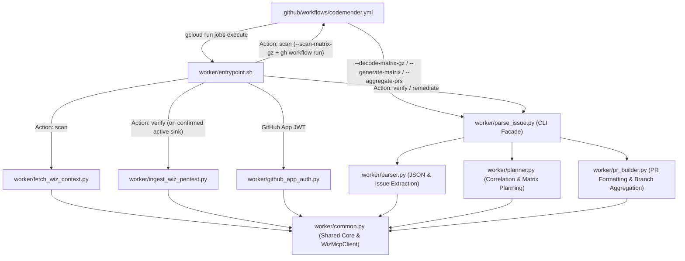

# CodeMender Slim

A lean, stateless, cloud-native automated security scanning and vulnerability remediation engine powered by **CodeMender (`cm`)**, **Google Gemini**, and **Wiz Security Graph MCP**.

[](https://shell.cloud.google.com/cloudshell/open?cloudshell_git_repo=https://github.com/wiz-demo/codemender-gemini-action&cloudshell_tutorial=tutorial.md)

---

## 🏗️ System & Module Architecture



---

## ⚡ Execution Modes

### 1. Discovery Scan & Wiz Export (`action: scan` $\rightarrow$ `action: verify`)
1. `fetch_wiz_context.py` queries Wiz MCP (`WizMcpClient`) for existing open CVEs, SAST flaws, secrets, and pentest findings.
2. `entrypoint.sh` executes `cm find . -c <wiz_context.md>`, compresses the candidate matrix (`gzip -9 + base64` via `--scan-matrix-gz`), and dispatches the verification workflow run via `gh workflow run ... -f action=verify -f matrix-gz-b64=...` (with zero git branch/artifact residue).
3. The `unpack-verify-matrix` job decodes the matrix payload (`--decode-matrix-gz`), and parallel `run-slim-verify` runners execute `cm verify <id>`. If and only after verification succeeds (confirmed active sink), `ingest_wiz_pentest.py` registers the confirmed flaw in Wiz Penetration Tests. Remediation (`action: remediate`) focuses solely on fixing code and never exports penetration tests.

## 🚀 Quickstart: Deploy & Run

### 1-Click Interactive Cloud Shell Setup (< 3 minutes)

Deploy the consumer infrastructure (the same resources as [`infra/consumer`](infra/consumer) Terraform) directly in Google Cloud Shell without configuring a local environment:

[](https://shell.cloud.google.com/cloudshell/open?cloudshell_git_repo=https://github.com/wiz-demo/codemender-gemini-action&cloudshell_tutorial=tutorial.md)

Clicking **Open in Google Cloud Shell** clones the repository and launches an interactive walkthrough that executes the idempotent `./setup.sh`:
- **API Enablement Validation**: Verifies and enables required Google Cloud APIs (`run.googleapis.com`, `secretmanager.googleapis.com`, `aiplatform.googleapis.com`, `logging.googleapis.com`, `iam.googleapis.com`, `storage.googleapis.com`).
- **Secure Wiz MCP Credentials**: Prompts securely with masked terminal input (`read -s`) for Wiz Service Account Client ID, Client Secret, DataCenter (required, no default), and Tenant Env (default `app`; e.g. `demo` selects `https://mcp.demo.wiz.io?mode=explicit`), storing `client_id`, `client_secret`, `datacenter`, and `mcp_url` in Google Cloud Secret Manager (`wiz-mcp-config`). Non-interactive runs use `--datacenter` / `WIZ_DATACENTER` and `--tenant-env`.
- **Runner Service Account & Minimal IAM**: Provisions `codemender-slim-runner` with least-privilege roles (`Secret Accessor`, `Vertex AI User`, `Logs Writer`, `Logs Viewer`, and `Cloud Run Developer`).
- **Scan Artifacts Bucket**: Creates `<PROJECT_ID>-codemender-artifacts` (uniform access, 1-day auto-delete) for scan matrix handoff and grants the runner `Storage Object User`.
- **Cloud Run Job Provisioning**: Configures the `wiz-codemender-slim` Cloud Run Job with 2 vCPUs, 4 GiB RAM, 30-minute timeout, 2 retries, and `SCAN_ARTIFACTS_BUCKET`.
- **GitHub Workload Identity Federation (Optional)**: Reuses or creates `codemender-pool` / `github-provider` and binds your downstream GitHub repository for keyless job execution. The script prints the `GCP_PROJECT`, `GCP_REGION`, `WIF_PROVIDER`, and `WIF_SERVICE_ACCOUNT` repository variables to set.

Alternatively, run the interactive setup script directly in your terminal (add `--dry-run` to preview, or `--help` for all flags):

```bash
git clone https://github.com/wiz-demo/codemender-gemini-action.git
cd codemender-gemini-action
./setup.sh
```

#### Deployment Modes

| Mode | Command | Provisions |
|---|---|---|
| Consumer (default) | `./setup.sh --image <IMAGE_URI>` | `infra/consumer` resources: runner SA, secret, artifacts bucket, Cloud Run Job, optional repo-scoped WIF |
| Builder / host only | `./setup.sh --builder --github-owner <OWNER>` | `infra/host` resources: Artifact Registry repo, `codemender-slim-builder` SA (`artifactregistry.writer`), org-scoped WIF for `deploy-worker.yml`, optional `--pull-member` / `--public-read` grants |
| Collapsed | `./setup.sh --collapsed --github-owner <OWNER> --github-repo owner/repo` | Both in one project, sharing **one** WIF pool/provider with **separate** builder and runner SAs; the job defaults to this project's `worker:slim` image |

WIF pools, providers, repos, and service accounts are always reused if they already exist; only missing pieces are created.

### Calling CodeMender Slim from GitHub Actions

Add the following caller workflow to any downstream repository (e.g. `.github/workflows/codemender.yml`):

```yaml
name: "CodeMender Security Suite"

on:
  schedule:
    - cron: "0 0 * * 0" # Weekly scheduled security scan & Wiz export
  issue_comment:
    types: [created]   # Comment '@cm-remediate' to trigger on an issue
  workflow_dispatch:
    inputs:
      action:
        description: "Operation: 'scan' (discover & export to Wiz) or 'remediate' (fix finding)"
        required: true
        default: "remediate"
        type: choice
        options:
          - remediate
          - scan

permissions:
  contents: write
  issues: write
  pull-requests: write
  id-token: write

jobs:
  codemender:
    if: >-
      github.actor != 'github-actions[bot]' &&
      !startsWith(github.head_ref, 'codemender/fix-') &&
      (
        github.event_name == 'schedule' ||
        github.event_name == 'workflow_dispatch' ||
        (
          github.event_name == 'issue_comment' &&
          contains(github.event.comment.body, '@cm-remediate')
        )
      )
    uses: <OWNER>/<REPO>/.github/workflows/codemender.yml@main
    secrets: inherit
    with:
      action: ${{ github.event_name == 'schedule' && 'scan' || github.event.inputs.action || 'remediate' }}
      project-id: ${{ vars.GCP_PROJECT }}
      region: ${{ vars.GCP_REGION }}
      job-name: "wiz-codemender-slim"
      channel: "stable" # Optional: 'experimental' runs <job-name>-experimental (see below)
      stream-logs: false # Optional: real-time Cloud Run log streaming (default: false)
      additional-logging: false # Optional: verbose debug logs, guidance & patch diffs (default: false)
```
### 2. Autonomous Vulnerability Remediation (`action: remediate`)
1. `planner.py` parses structured downstream agent JSON or plain-text issues into owner/file-grouped matrix tasks.
2. Parallel Cloud Run jobs execute `cm fix <id> -c <recommended_fixes>` on isolated runner branches.
3. `pr_builder.py` merges runner branches per owner and opens consolidated Draft Pull Requests with severity labels and Wiz metadata links.

---

## 🧪 Experimental Worker Channel

Test worker changes end-to-end without touching the stable image or job.

| | Stable | Experimental |
|---|---|---|
| Image tag | `worker:slim` | `worker:slim-experimental` |
| Built by | push/merge to `main`, twice-weekly cron, or manual dispatch on `main` | push or manual dispatch on any non-`main` branch |
| Cloud Run job | `<job-name>` | `<job-name>-experimental` (override with `experimental-job-name`) |
| Caller input | `channel: stable` (default) | `channel: experimental` |

The channel is derived strictly from the branch ref (`refs/heads/main` → `worker:slim`, anything else → `worker:slim-experimental`), so feature branches can never overwrite `worker:slim`.

> [!IMPORTANT]
> Cloud Run jobs pin the image **digest** when deployed. Pushing a new tag does not change an existing job; roll it forward manually (the build summary prints this command):
> ```bash
> gcloud run jobs update <job-name>[-experimental] --image=<REGION>-docker.pkg.dev/<HOST_PROJECT>/<AR_REPO>/worker:<slim|slim-experimental> \
>   --project=<CONSUMER_PROJECT> --region=<REGION>
> ```

### One-time: create the experimental job

Clone your stable job so the service account, secrets, env vars and resources stay identical, and swap only the name and image:

```bash
PROJECT=<CONSUMER_PROJECT>; REGION=<REGION>; JOB=wiz-codemender-slim
IMAGE=<REGION>-docker.pkg.dev/<HOST_PROJECT>/<AR_REPO>/worker:slim-experimental

gcloud run jobs describe "$JOB" --project="$PROJECT" --region="$REGION" --format=export > job.yaml
sed -i -e "s|^  name: ${JOB}\$|  name: ${JOB}-experimental|" -e "s|image: .*|image: ${IMAGE}|" job.yaml
gcloud run jobs replace job.yaml --project="$PROJECT" --region="$REGION"
```

### Development loop

1. Push worker changes to a feature branch (or manually dispatch **Build & Publish CodeMender Worker** on that branch) to publish `worker:slim-experimental`.
2. Run `gcloud run jobs update <job-name>-experimental --image=...:slim-experimental` (see above).
3. Trigger the caller with `channel: experimental`.

> [!NOTE]
> The channel only selects the **worker image/job**. To test changes to the reusable workflow YAML itself, point the caller at your branch: `uses: <OWNER>/<REPO>/.github/workflows/codemender.yml@<branch>`.
> Several developers sharing one consumer project can each clone their own job (e.g. `wiz-codemender-slim-alice`) and select it with `experimental-job-name`.

---

## 🛠️ Repository Layout

```
codemender-gemini-action/
├── worker/
│   ├── .codemender/            # Burnt-in fallback CodeMender config and command policy
│   │   ├── config.yaml         # Default scan paths, extensions, and build validation settings
│   │   └── command_policy.yaml # Allowed command executions (unblocks toolchain commands)
│   ├── common.py               # Shared core: path/severity helpers, JSON I/O, Secret Manager, WizMcpClient
│   ├── parser.py               # JSON candidate extraction, downstream agent parser, regex fallback
│   ├── planner.py              # Finding ID correlation (JSON + SQLite), verification check, matrix generation
│   ├── pr_builder.py           # Conventional PR title/body builders & owner branch aggregation
│   ├── parse_issue.py          # Unified CLI dispatcher & backwards-compatible re-export facade
│   ├── fetch_wiz_context.py    # Wiz MCP security graph harvester & Markdown renderer
│   ├── ingest_wiz_pentest.py   # Verified finding ingestion into Wiz Penetration Tests
│   ├── github_app_auth.py      # RS256 JWT & GitHub App installation token minter
│   ├── entrypoint.sh           # Modular container entrypoint (setup_auth_and_workspace, run_scan, run_verify, run_remediate)
│   └── Dockerfile              # Stateless container image definition
├── .github/workflows/
│   ├── codemender.yml          # Centralized reusable workflow (scan, verify, plan, remediate, aggregate)
│   └── deploy-worker.yml       # Container image builder & publisher
├── infra/                      # Terraform definitions for host & consumer projects
├── setup.sh                    # Interactive / idempotent consumer provisioner (Cloud Shell)
├── tutorial.md                 # Cloud Shell walkthrough launched by the "Open in Cloud Shell" button
├── tests/                      # Unit & integration test suite
└── docs/                       # Architectural & GraphQL mutation reference
```

---

### ⚙️ CodeMender Configuration & Policy Override Hierarchy

The worker container pre-bakes baseline configuration and command policies from `worker/.codemender/` into the image as fallbacks (`config.yaml` and `command_policy.yaml`).

Calling sub-repositories (such as projects invoking `.github/workflows/codemender-slim.yml`) can customize their CodeMender behavior by placing a `.codemender` folder in their repository root:
- **`config.yaml`**: When present in `<subrepo>/.codemender/config.yaml`, the worker container applies the sub-repository's configuration (such as custom build/test commands, scan extensions, and timeout limits). If omitted, the worker image's burnt-in `config.yaml` is used as fallback.
- **`command_policy.yaml`**: When present in `<subrepo>/.codemender/command_policy.yaml`, the worker container enforces the sub-repository's command policy. If omitted, the worker image's burnt-in `command_policy.yaml` is used as fallback.
- **Auxiliary Assets**: Any additional files placed inside `<subrepo>/.codemender/` (e.g. templates, rules) are synchronized into the active `~/.codemender/` workspace.

---

## 🧪 Running Tests

```bash
PYTHONPATH=worker python3 -m unittest discover -s tests -v
```
