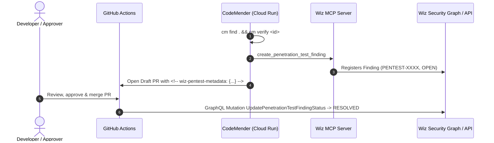

# Automated Wiz Penetration Test Finding Resolution (Design & Reference)

> **Status:** Reference Architecture  
> **Target System:** CodeMender Slim Worker (`worker/`) & GitHub Actions

---

## 1. Objective

Vulnerabilities handled by CodeMender proceed through three phases:
1. **Discovery & Validation:** CodeMender scans (`cm find`), validates exploitability (`cm verify`), and registers confirmed flaws in Wiz Penetration Tests via Wiz MCP (`ingest_wiz_pentest.py`).
2. **Autonomous Remediation:** CodeMender generates patches (`cm fix`) and opens a Draft Pull Request containing structured metadata linking back to the Wiz Finding ID.
3. **Post-Merge Resolution:** When an engineer merges the Pull Request, a centralized resolver transitions the Wiz Penetration Test finding to **`RESOLVED`**.

---

## 2. End-to-End Lifecycle



---

## 3. Why Centralized Resolution

| Dimension | Centralized Reusable Workflow | Per-Repository Workflow |
| :--- | :--- | :--- |
| **Credentials** | Central Secret Manager (`wiz-mcp-config`); downstream repos hold zero Wiz secrets. | Every repository requires Wiz API credentials. |
| **Maintenance** | Single workflow maintained in one repository. | Must update dozens of downstream repositories. |
| **Blast Radius** | Isolated to the central runner environment. | Compromise of any app repo exposes shared Wiz credentials. |

---

## 4. Technical Design: Metadata Bridge & GraphQL Mutation

Because the Wiz MCP server exposes read/create tools (`list_penetration_test_findings`, `create_penetration_test_finding`) but does not expose status mutation tools, post-merge status updates use the `UpdatePenetrationTestFindingStatus` GraphQL mutation:

```graphql
mutation UpdatePenetrationTestFindingStatus($input: UpdatePenetrationTestFindingStatusInput!) {
  updatePenetrationTestFindingStatus(input: $input) {
    penetrationTestFinding {
      id
      statusV2
      resolutionReasonV2
    }
  }
}
```

### Variables Payload
```json
{
  "input": {
    "id": "PENTEST-12345",
    "statusV2": "RESOLVED",
    "note": "Remediated and automatically resolved via merged CodeMender PR #42 in owner/repo."
  }
}
```

### Pull Request Metadata Comment
`worker/pr_builder.py` embeds the correlation tag into every PR body when `wiz_id` is present:
```html
<!-- wiz-pentest-metadata: {"id": "PENTEST-12345", "repo": "owner/repo", "cm_id": "a1b2c3d4"} -->
```
